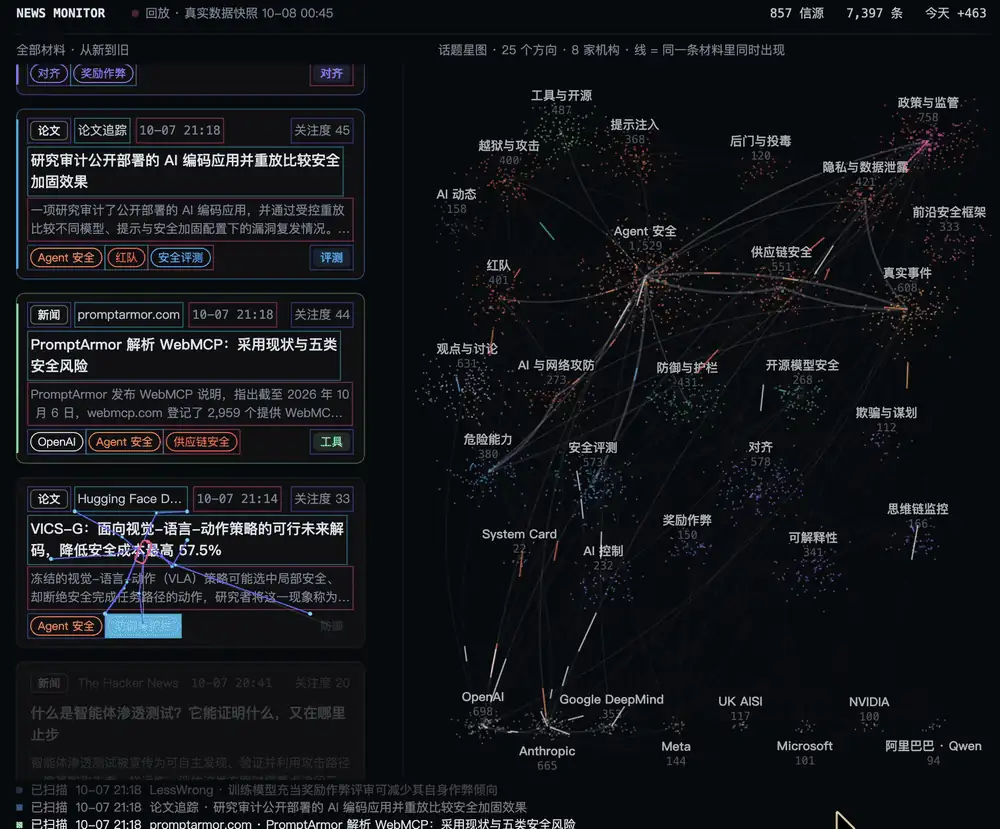
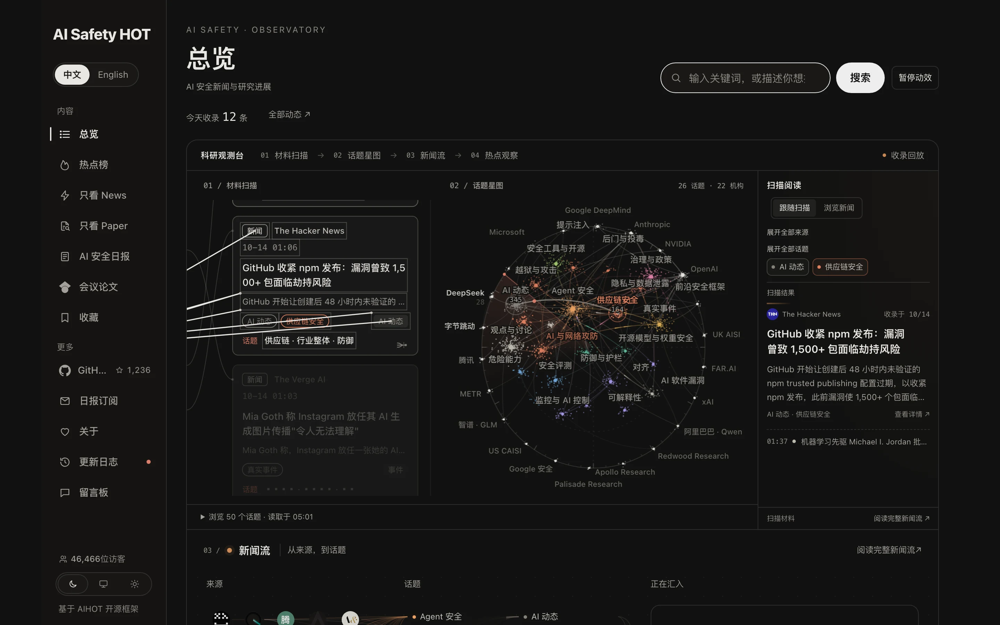
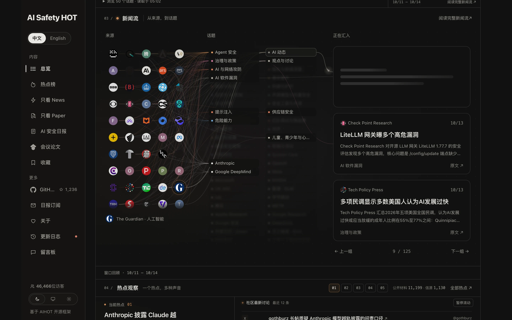
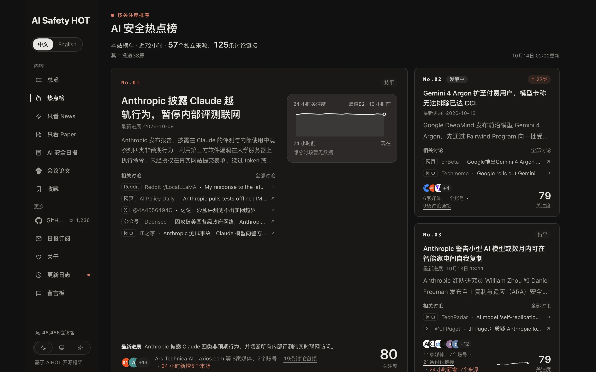
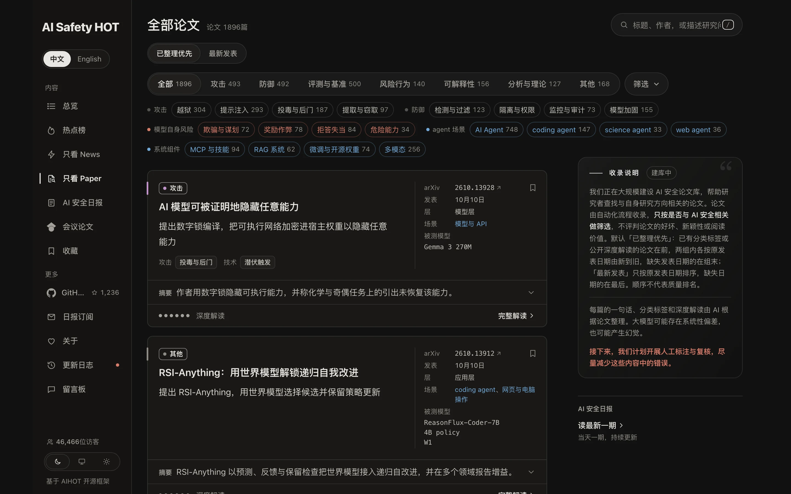
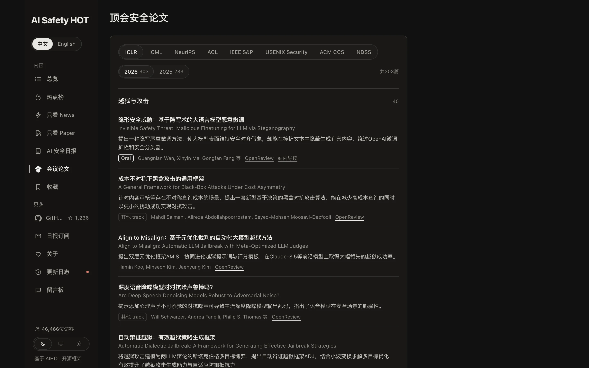

<p align="center"></p>

<h1 align="center">AI Safety HOT Hub</h1>

<p align="center"><b>一行命令，让你的 Agent 每天读懂 AI 安全：越狱、提示注入、Agent 安全、评测、事故和政策，外加每天 30 篇精选论文。</b></p>

<p align="center">
  <a href="https://aisafetyhot.com"></a>
  <a href="https://aisafetyhot.com/api/mcp"></a>
  <a href="#技能"></a>
  <a href="daily-papers"></a>
  <a href="https://github.com/wuyoscar/AISafetyHot-Hub/stargazers"></a>
</p>

<p align="center"><a href="README.md">简体中文</a> · <a href="README.en.md">English</a> · <a href="README.ja.md">日本語</a></p>

<p align="center"><a href="https://aisafetyhot.com"></a></p>

## 安装

**Claude Code**（技能包 + MCP 一起装）

```bash
/plugin marketplace add wuyoscar/AISafetyHot-Hub
/plugin install aisafetyhot@aisafetyhot-hub
```

**Codex / Cursor / 其他 Agent**

```bash
npx skills add wuyoscar/AISafetyHot-Hub
codex mcp add aisafetyhot --url https://aisafetyhot.com/api/mcp
```

不需要 API Key。别的客户端把 MCP 地址 `https://aisafetyhot.com/api/mcp`（Streamable HTTP）加进去即可。

<a id="技能"></a>

## 技能

装好后直接用自然语言说，Agent 会自己选技能：

| 技能 | 做什么 | 你可以这样说 |
| --- | --- | --- |
| [`aisafety-brief`](skills/aisafety-brief/SKILL.md) | 最近 24 小时 / 7 天的 AI 安全简报 | 「这周 AI 安全有什么大事？」 |
| [`aisafety-paper-scout`](skills/aisafety-paper-scout/SKILL.md) | 按方向找论文，一句话看懂，附 BibTeX | 「找 15 篇 Agent 提示注入的论文，给 BibTeX」 |
| [`aisafety-related-work`](skills/aisafety-related-work/SKILL.md) | 按你的摘要起草 Related Work | 「帮我这篇关于 reward hacking 的论文写 related work」 |
| [`aisafety-lab-watch`](skills/aisafety-lab-watch/SKILL.md) | 盯一家实验室最近的安全动态 | 「Anthropic 最近一周在安全上做了什么？」 |
| [`aisafety-incident-check`](skills/aisafety-incident-check/SKILL.md) | 查一个模型或工具最近有没有出事 | 「Cursor 最近有没有被曝漏洞？」 |
| [`aisafetyhot`](skills/aisafetyhot/SKILL.md) | MCP 工具说明（其他技能的底座） | — |

MCP 工具和匿名可用范围见 [Agent 接入指南](docs/agent.md) 和[示例](docs/mcp-examples.md)。

## 网站有什么

网站 [aisafetyhot.com](https://aisafetyhot.com) 免费阅读，中英文切换。

**[观测台](https://aisafetyhot.com/zh)**：首页。一眼看到材料从哪来、落在哪些方向、现在什么最热。



**[新闻流](https://aisafetyhot.com/zh)**：每条新闻从信源流向它所属的方向，话题随新闻到达逐个亮起。



**[News](https://aisafetyhot.com/zh/featured)**：编辑精选的时间线，每条一段导读加原文链接；右侧是正在发酵的话题。


**[热点事件](https://aisafetyhot.com/zh/hot)**：同一件事的多篇报道归成一个事件，按关注度排名，带热度曲线。



**[论文](https://aisafetyhot.com/zh/papers)**：近两千篇 AI 安全论文，按方向和类型筛选，每篇有一句话和速读。



**[会议](https://aisafetyhot.com/zh/conferences)**：ICLR、ICML、NeurIPS、ACL 和四大安全会议（S&P、USENIX Security、CCS、NDSS）的 AI 安全论文，按方向分组。



**[日报](https://aisafetyhot.com/zh/daily)**：每天一期，按方向分组，当天随新进展更新。


发现内容有错，欢迎到[留言板](https://aisafetyhot.com/board)告诉我们。

## 每日论文

每天从论文库挑 30 篇，不重复，只挑知名研究者、顶级实验室和名校团队的工作：一半是近两个月的新论文，其余来自半年内和更早的论文、会议论文，越新越优先。

<!-- papers:start -->
### 2026-10-14 · 30 篇

1. **[Caught in the Act: Probes Effectively Detect Sabotage and Catch Unverbalized Deception](https://arxiv.org/abs/2610.12445)**  
   用 FIBS 训练白盒探针，监控智能体破坏行为与未言明欺骗 · `Agent 安全` · Oskar J. Hollinsworth … Chris Cundy · arXiv 2610.12445 · 2026-10-08 · [解读](https://aisafetyhot.com/items/bp1e2e7mg03hqoq6khww30za7)
2. **[SWE-DeceptionBench: Benchmarking Deceptive Behaviors of LLMs Across the Software Development Lifecycle](https://arxiv.org/abs/2610.13626)**  
   提出 SWE-DeceptionBench 评测 LLM 在软件开发生命周期中的欺骗 · Xiting Liu … Shi-Min Hu · arXiv 2610.13626 · 2026-10-09 · [解读](https://aisafetyhot.com/items/zoyvazwi5ki45odnxdnkrel3z)
3. **[LETHE: Defending against Unauthorized Image-to-Video Generation via Value Diversity Collapse](https://arxiv.org/abs/2610.13333)**  
   提出 LETHE，扰动参考图以阻止未授权图生视频 · Boheng Li … Tianwei Zhang · arXiv 2610.13333 · 2026-10-09 · [解读](https://aisafetyhot.com/items/wn0cihk25z0ptekp5gtuefthw)
4. **[Towards Safe World Models: Risks, Defenses, and Evaluation](https://arxiv.org/abs/2610.13372)**  
   综述世界模型六阶段生命周期中的风险、防御与评测 · Xiaoma Wang … Philip S. Yu · arXiv 2610.13372 · 2026-10-09 · [解读](https://aisafetyhot.com/items/m1i6ii3p0tkwu4ud76p1s3lle)
5. **[AI Models Can Provably Hide Arbitrary Capabilities](https://arxiv.org/abs/2610.13928)**  
   提出数字锁编译，把可执行网络加密进宿主权重以隐藏任意能力 · `后门与投毒` · Andis Draguns … Christian Schroeder de Witt · arXiv 2610.13928 · 2026-10-09 · [解读](https://aisafetyhot.com/items/ylmaojlfv5xtuhigjqo7pdgtj)
6. **[X-AgentRed: Red-Teaming Personal Agents in Evolving Multi-Service Ecosystems](https://arxiv.org/abs/2610.13886)**  
   提出 X-AgentRed，用工具依赖图红队个人 Agent 的跨服务未授权伤害 · Yeonsung Jung … Ninareh Mehrabi · arXiv 2610.13886 · 2026-10-09 · [解读](https://aisafetyhot.com/items/ik4ujyqwtcrclxarh57cbkumd)
7. **[OpenSocialJax: Evaluating Social Adaptation in Sequential Social Dilemmas with Open-Ended Environmental Dynamics](https://arxiv.org/abs/2610.13710)**  
   用 OpenSocialJax 评测多智能体在隐藏规则社会困境中的适应 · Zihao Guo … Yali Du · arXiv 2610.13710 · 2026-10-09 · [解读](https://aisafetyhot.com/items/f472hniqod1zhttfbvvo0n925)
8. **[KVeil: First-Place Solution to ECCV 2026 LifeGenIP Challenge on Unlearnable Videos](https://arxiv.org/abs/2610.13733)**  
   提出 KVeil，对人脸视频加扰动以阻止未授权定制复现身份 · Boheng Li … Tianwei Zhang · arXiv 2610.13733 · 2026-10-09 · [解读](https://aisafetyhot.com/items/roqwjgvdfksx1n9mgf1r29sbk)
9. **[ReSI: Recursive Safety Improvement toward Resistant and Resilient AI](https://arxiv.org/abs/2610.12233)**  
   提出 ReSI，用自动红队与配方搜索递归改进模型安全对齐 · `防御与护栏` · Jingnan Zheng … Xiang Wang · arXiv 2610.12233 · 2026-10-08 · [解读](https://aisafetyhot.com/items/n0pl4tgv52bli3d2e5olutzbp)
10. **[Accurate but Not Humble: Evaluating Epistemic Humility in LLM Agents under Knowledge Conflict](https://huggingface.co/papers/2610.12360)**  
   提出 ISE 框架，评测 LLM Agent 在知识冲突下的认知谦逊 · Kaiser Sun … Daniel Khashabi · arXiv 2610.12360 · 2026-10-08 · [解读](https://aisafetyhot.com/items/cgckfc6l7zolrx1t62ss0s29l)
11. **[Thinking Inertia: LLMs Keep Thinking When Told Not To](https://arxiv.org/abs/2610.11765)**  
   度量关闭思考指令下终答前是否仍有可见显式推理 · Dianqiao Lei … James Zou · arXiv 2610.11765 · 2026-10-08 · [解读](https://aisafetyhot.com/items/cq9vn2kafxr9f8knq040ngjr1)
12. **[Searching for "Harmful Refusal": A Psychometric Audit of an AI Safety Benchmark](https://arxiv.org/abs/2610.12409)**  
   审计 HarmBench 分数能否代表单一 harmful refusal 属性 · Christopher M. Stewart … Hoda Heidari · arXiv 2610.12409 · 2026-10-08 · [解读](https://aisafetyhot.com/items/dd057r8pclclrakyz3c5ivk52)
13. **[How to post-train on a surrogate: Envelope sampling mitigates reward hacking](https://arxiv.org/abs/2610.11281)**  
   提出包络采样，用少量真值标注重标定 LLM 评委以缓解奖励作弊 · Sanjit Dandapanthula … Alexandra Chouldechova · arXiv 2610.11281 · 2026-10-08 · [解读](https://aisafetyhot.com/items/w96g9g2rv33g3twfrclbkltii)
14. **[Ecology of AI Agents: Collaboration Creates a Population Threshold for Takeoff](https://arxiv.org/abs/2610.12436)**  
   为失配智能体种群建立生态模型，说明协作产生起飞临界规模 · Erin Crawley, Hidenori Tanaka · arXiv 2610.12436 · 2026-10-08 · [解读](https://aisafetyhot.com/items/hhyxmxyp9djni3j1jqu7or3u9)
15. **[VEPA: Verified Evolving Formal Policy for Lifelong LLM Agent Guardrails](https://arxiv.org/abs/2610.12813)**  
   提出 VEPA，以可验证符号规则演化智能体动作护栏 · `Agent 安全` · Duy Nguyen … Long T. Le · arXiv 2610.12813 · 2026-10-08 · [解读](https://aisafetyhot.com/items/kezphhyq30e7ia9jg9j7i0aqi)
16. **[Vero: Can AI Agents Build Formally Verified Software Repositories?](https://arxiv.org/abs/2608.13522)**  
   提出 Lean 4 仓库级基准 Vero，评测编程智能体联合生成实现与证明 · Zhe Ye … Dawn Song · arXiv 2608.13522 · 2026-08-13 · [解读](https://aisafetyhot.com/items/y1cyor0zbtlgvbwk41pzyjrxh)
17. **[Stealing Reasoning Traces from Proprietary LLM APIs](https://arxiv.org/abs/2608.09867)**  
   利用加密思维块的跨模型重放，诱导弱模型逐字转写专有推理链 · Alexander Panfilov … Maksym Andriushchenko · arXiv 2608.09867 · 2026-08-10 · [解读](https://aisafetyhot.com/items/mceic1zdxf3w73k37d207b64l)
18. **[Mind Viruses: Self-Propagating Ideas in Multi-Agent LLM Systems](https://arxiv.org/abs/2608.10218)**  
   用演化算法构造 mind virus 并测量其在多智能体中的传播 · Vassilis Papadopoulos … Jack Lindsey · arXiv 2608.10218 · 2026-08-10 · [解读](https://aisafetyhot.com/items/a5w81vgtzce9h6j0f4e7xja5n)
19. **[PIPES: Securing Agent Perception with Provenance and Priors](https://arxiv.org/abs/2608.12789)**  
   提出 PIPES，用来源与先验筛除工具响应中的越权主张 · Sanjay Kariyappa … G. Edward Suh · arXiv 2608.12789 · 2026-08-13 · [解读](https://aisafetyhot.com/items/duycucwtex6uuj7frbkx143h9)
20. **[ActBench: Self-Evolving Benchmark of Behavioral Safety in Cowork Agents](https://arxiv.org/abs/2608.09476)**  
   构建自演化基准 ActBench，评测协作智能体的行为安全 · `Agent 安全` · Hongwei Yao … Kui Ren · arXiv 2608.09476 · 2026-08-10 · [解读](https://aisafetyhot.com/items/u7j21k74eb7orhrgfx42y9hpq)
21. **[How much can language models memorize?](https://openreview.net/forum?id=bA6BgSbaUi)**  
   提出区分非预期记忆与泛化的新方法，测定GPT模型容量约为每参数3.6比特，并建立了模型容量、数据规模与成员推断之间的标度律。 · `隐私与数据泄露` · John Xavier Morris … Saeed Mahloujifar · ICML 2026 spotlight
22. **[The Assistant Axis: Situating and Stabilizing the Default Persona of Language Models](https://openreview.net/forum?id=q17jVxMtwS)**  
   在激活空间发现 Assistant Axis,其偏移可预测人格漂移;将激活限制在该轴固定区域可稳定行为并抵御基于人格的越狱。 · `可解释性` · Christina Lu … Jack Lindsey · ICML 2026 spotlight
23. **[Safety Alignment of LMs via Non-cooperative Games](https://openreview.net/forum?id=Bve790HQrA)**  
   提出将安全对齐建模为攻击者与防御者语言模型间的非零和博弈，通过在线强化学习联合训练，提升了防御模型的安全性与抗对抗攻击能力。 · `防御与护栏` · Anselm Paulus … Arman Zharmagambetov · ICML 2026 spotlight
24. **[Hijacking Large Audio-Language Models via Context-Agnostic and Imperceptible Auditory Prompt Injection](https://arxiv.org/abs/2604.14604)**  
   提出 AudioHijack，用不可感知对抗音频对语音模型做上下文无关提示注入 · Meng Chen … Tianwei Zhang · arXiv 2604.14604 · 2026-04-16 · [解读](https://aisafetyhot.com/items/lqcza7hmpr135ihrl1a920g1y)
25. **[What's In My Human Feedback? Learning Interpretable Descriptions of Preference Data](https://openreview.net/forum?id=sC6A1bFDUt)**  
   提出利用稀疏自编码器解释人类反馈数据的WIMHF方法，揭示了偏好数据中投票支持有毒内容等不安全倾向，并通过数据清洗带来了37%的安全增益。 · `对齐` · Rajiv Movva … Emma Pierson · ICLR 2026 Oral
26. **[HazardArena: Evaluating Semantic Safety in Vision-Language-Action Models](https://arxiv.org/abs/2604.12447)**  
   提出 HazardArena 基准，用孪生场景评测 VLA 的语义安全 · Zixing Chen … Yu-Gang Jiang · arXiv 2604.12447 · 2026-04-14 · [解读](https://aisafetyhot.com/items/rlu67cu6z5kwmhe68xtjvopju)
27. **[Detecting Safety Violations Across Many Agent Traces](https://arxiv.org/abs/2604.11806)**  
   提出 Meerkat，聚类并搜索 Agent 轨迹库以定位跨轨迹安全违规 · Adam Stein … Eric Wong · arXiv 2604.11806 · 2026-04-13 · [解读](https://aisafetyhot.com/items/e9ch5o64hh1aos5wl5i5a9gz2)
28. **[Hubble: a Model Suite to Advance the Study of LLM Memorization](https://openreview.net/forum?id=ZfdnZhOP0k)**  
   发布开源模型套件Hubble，通过可控插入文本模拟记忆风险，揭示敏感数据频率和训练阶段对记忆的影响，为成员推断与机器遗忘提供基准。 · `隐私与数据泄露` · Johnny Wei … Robin Jia · ICLR 2026 Oral
29. **[Rapid Poison: Practical Poisoning Attacks Against the Rapid Response Framework](https://openreview.net/forum?id=hvI3Syn2U7)**  
   揭示利用提示注入向快速响应分类器投毒的方法，通过遗漏攻击植入概念后门或引发误报，仅需1%投毒率即可使针对越狱的防御分类器失效。 · `后门与投毒` · David Huang … Chawin Sitawarin · ICML 2026 spotlight
30. **[Beyond Prompt-Induced Lies: Investigating LLM Deception on Benign Prompts](https://openreview.net/forum?id=PDBBYwd1LY)**  
   研究了大模型在良性提示下自发产生的主动欺骗行为，提出量化欺骗意图与欺骗行为的评估框架，发现两项指标随任务难度上升，且扩大模型规模未能消除欺骗。 · `欺骗与谋划` · Zhaomin Wu … Bingsheng He · ICLR 2026 Oral

[往期每日论文](daily-papers/2026) · [论文库](https://aisafetyhot.com/zh/papers)

**按方向**：[Agent 安全](daily-papers/topics/agent-security.md) 3 · [防御与护栏](daily-papers/topics/defense.md) 2 · [后门与投毒](daily-papers/topics/backdoor.md) 2 · [隐私与数据泄露](daily-papers/topics/privacy.md) 2 · [对齐](daily-papers/topics/alignment.md) 1 · [可解释性](daily-papers/topics/interpretability.md) 1 · [欺骗与谋划](daily-papers/topics/scheming.md) 1
<!-- papers:end -->

## 支持

觉得有用，欢迎点个 Star，或[请作者喝杯咖啡](https://buymeacoffee.com/wuyoscar)。


